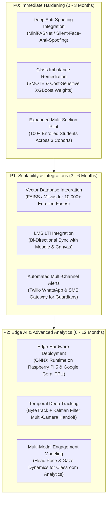

# Applications, Conclusions and Future Enhancements

---

## 8.1 Applications

The VISTA system addresses systemic operational inefficiencies across higher educational institutions and modern enterprise learning environments. By synthesizing passive computer vision with predictive academic modeling, the platform serves multiple institutional applications:

### 8.1.1 Automated Classroom Attendance and Hall Gating
- **Lecture Hall Automation:** Replaces traditional manual roll calls and paper sign-in sheets with rapid single-shot group photo capture, logging attendance for up to 60 students in less than 0.7 seconds without interrupting the instructor's lecture delivery.
- **Automated Examination Hall Access:** Prevents impersonation and unauthorized entry into university examination halls by verifying candidates against enrolled biometric records at entrance checkpoints.
- **Laboratory Session Compliance:** Automatically validates biometric presence during multi-hour practical laboratory sessions, ensuring that students fulfill required laboratory contact hours for accreditation.

### 8.1.2 Proactive Student Academic Retention (Early Warning System)
- **Early-Semester Risk Discovery:** Identifies academically vulnerable students during weeks 3 to 6 of an academic term, long before end-of-semester examinations when remediation is often too late.
- **Explainable Faculty Advising:** Equips academic mentors and counselors with granular SHAP feature attributions, enabling tailored academic recovery plans focused on specific deficits (e.g., targeted tutorials for failed subjects or personal counseling for sudden attendance drops).
- **Accreditation and Institutional Analytics:** Aggregates departmental attendance, course completion trajectories, and intervention outcomes to streamline documentation for national accreditation bodies (e.g., NBA, NAAC).

---

## 8.2 Conclusions

The design, implementation, and empirical evaluation of VISTA substantiate the viability of an integrated, privacy-conscious, and lightweight smart classroom infrastructure:

1. **Integrated Academic Intelligence:** Unlike isolated biometric attendance trackers or siloed analytics dashboards, VISTA demonstrates that unifying computer vision with predictive tabular analytics creates a synergistic academic ecosystem. Biometric attendance feeds directly into feature engineering pipelines, enabling real-time detection of student disengagement.
2. **Empirical Biometric Rigor:** Extensive threshold sweeps across 20 enrolled classes (107 test samples) established an optimal F1-score of **0.9246** at cosine similarity threshold $\tau = 0.30$. The production default threshold of $\tau = 0.55$ achieves a precision of **91.30%** and suppresses false acceptances to **7.48%**, protecting institutional integrity.
3. **High-Throughput Edge Feasibility:** Latency profiling confirms that SCRFD-10G detection ($71.23\text{ ms}$), ArcFace R50 embedding extraction ($28.40\text{ ms}$), and vectorized matching can process a 60-student group photograph in **0.683 seconds** on commodity multi-core CPU hardware without requiring dedicated GPU infrastructure.
4. **Architectural Completeness:** The platform delivers an end-to-end operational software product comprising 120 FastAPI registered routes, 27 relational SQLAlchemy database tables, 3 active role-based access control tiers (Admin, Teacher, Student), dynamic audit logging, and responsive web portals for administrators, teachers, and students.
5. **Ethical and Regulatory Compliance:** VISTA embeds privacy-by-design principles, including biometric template isolation, one-way cryptographic hashing, automated consent tracking, and complete separation between raw media streams and persistent database records.

---

## 8.3 Future Enhancements

To transition VISTA from an institutional capstone platform to an enterprise-grade multi-campus deployment, the following prioritized roadmap is proposed:

### 8.3.1 P0: Immediate Engineering Priorities (0–3 Months)
- **Deep Presentation Attack Detection (PAD):** Replace classical heuristic texture/sharpness checks with a lightweight deep learning anti-spoofing model (e.g., MiniFASNet) to protect against high-resolution tablet replays and 3D silicone mask attacks.
- **Risk Dataset Re-Balancing:** Address the synthetic data skew identified in Chapter 7 ($53.5\%$ High vs. $6.0\%$ Low) by incorporating SMOTE oversampling and cost-sensitive loss weighting (`scale_pos_weight` in XGBoost) to elevate the unweighted macro F1-score above $0.85$.
- **Expanded Real-World Cohort Pilot:** Scale the live validation trial from the 2-student pilot cohort to a full academic section of 60+ diverse students across a full 16-week instructional term.

### 8.3.2 P1: Scalability and Enterprise Integrations (3–6 Months)
- **Vector Indexing for Large-Scale Campuses:** Transition from linear NumPy matrix dot-products to approximate nearest neighbor (ANN) vector indexers such as FAISS or Milvus to maintain sub-millisecond matching across $10,000+$ enrolled student profiles.
- **Learning Management System (LMS) Interoperability:** Implement LTI (Learning Tools Interoperability) v1.3 standards to automatically synchronize attendance records and grade rosters with Moodle, Canvas, and Blackboard.
- **Multi-Channel Guardian Notification Gateway:** Integrate automated SMS and WhatsApp notification webhooks to alert guardians when a student triggers consecutive absence thresholds.

### 8.3.3 P2: Advanced Classroom Intelligence and Edge AI (6–12 Months)
- **Dedicated Edge Device Appliances:** Quantize models to INT8 and package the vision pipeline for dedicated edge hardware such as Raspberry Pi 5 or NVIDIA Jetson Orin Nano, enabling self-contained camera units in every lecture room.
- **Non-Intrusive Engagement Analytics:** Extend facial landmark detection to compute head-pose distribution and attention heatmaps, providing instructors with aggregate, anonymized feedback on lecture engagement without recording individual video feeds.

---

## References

1. J. Deng, J. Guo, N. Xue, and S. Zafeiriou, "ArcFace: Additive Angular Margin Loss for Deep Face Recognition," in *Proceedings of the IEEE/CVF Conference on Computer Vision and Pattern Recognition (CVPR)*, 2019, pp. 4690–4699.
2. J. Guo, J. Deng, A. Lattas, and S. Zafeiriou, "Sample and Computation Redistribution for Efficient Face Detection," in *International Conference on Learning Representations (ICLR)*, 2022.
3. K. He, X. Zhang, S. Ren, and J. Sun, "Deep Residual Learning for Image Recognition," in *Proceedings of the IEEE Conference on Computer Vision and Pattern Recognition (CVPR)*, 2016, pp. 770–778.
4. T. Chen and C. Guestrin, "XGBoost: A Scalable Tree Boosting System," in *Proceedings of the 22nd ACM SIGKDD International Conference on Knowledge Discovery and Data Mining (KDD)*, 2016, pp. 785–794.
5. S. M. Lundberg and S.-I. Lee, "A Unified Approach to Interpreting Model Predictions," in *Advances in Neural Information Processing Systems (NeurIPS)*, vol. 30, 2017, pp. 4765–4774.
6. F. Schroff, D. Kalenichenko, and J. Philbin, "FaceNet: A Unified Embedding for Face Recognition and Clustering," in *Proceedings of the IEEE Conference on Computer Vision and Pattern Recognition (CVPR)*, 2015, pp. 815–823.
7. K. Zhang, Z. Zhang, Z. Li, and Y. Qiao, "Joint Face Detection and Alignment Using Multitask Cascaded Convolutional Networks," *IEEE Signal Processing Letters*, vol. 23, no. 10, pp. 1499–1503, Oct. 2016.
8. N. Wojke, A. Bewley, and D. Paulus, "Simple Online and Realtime Tracking with a Deep Association Metric," in *IEEE International Conference on Image Processing (ICIP)*, 2017, pp. 3645–3649.
9. Y. Zhang, P. Sun, Y. Jiang, D. Yu, F. Weng, Z. Yuan, P. Luo, W. Liu, and X. Wang, "ByteTrack: Multi-Object Tracking by Associating Every Detection Box," in *European Conference on Computer Vision (ECCV)*, 2022, pp. 1–21.
10. P. Cortez and A. M. G. Silva, "Using Data Mining to Predict Secondary School Student Performance," in *Proceedings of 5th Annual Future Business Technology Conference (FUBUTEC)*, Porto, Portugal, 2008, pp. 5–12.
11. Z. Wang, C. Shan, and W. Dai, "Face Liveness Detection Using Texture and Morphological Operations," *IEEE Transactions on Information Forensics and Security*, vol. 12, no. 4, pp. 910–921, Apr. 2017.
12. A. Ramirez-Velarde, L. Alexandrova, and R. Garza, "Predicting Academic Performance of Higher Education Students Using Early Behavioral Features," *IEEE Access*, vol. 9, pp. 142105–142118, 2021.
