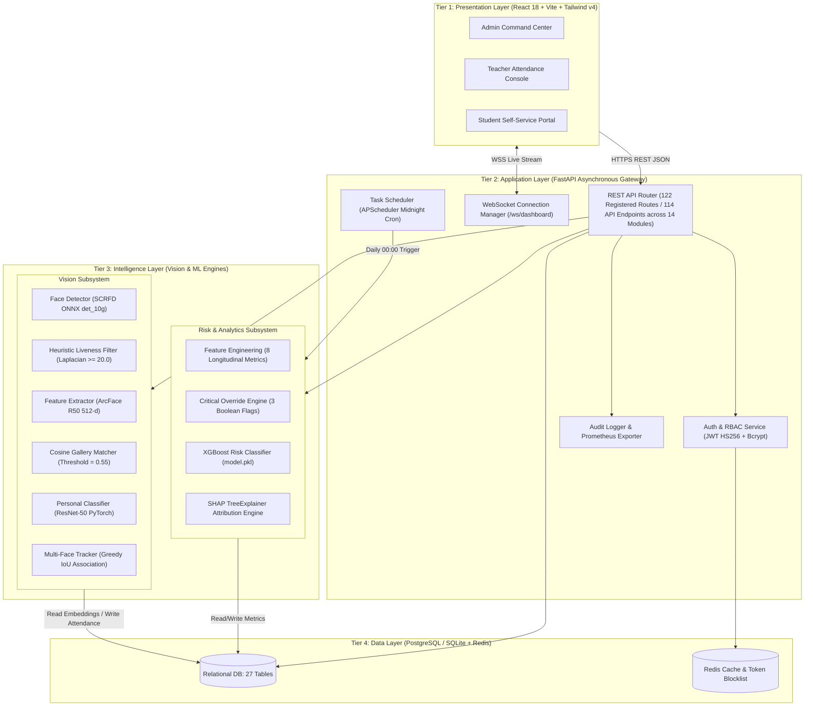
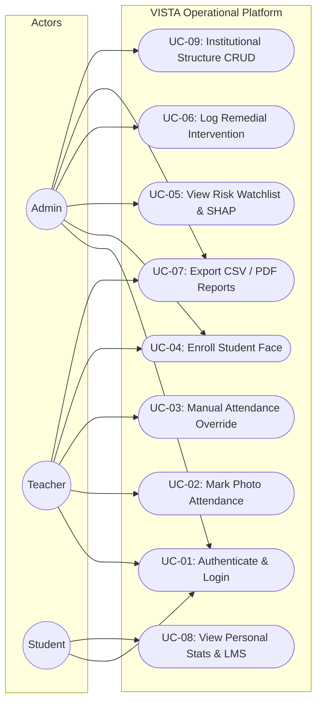
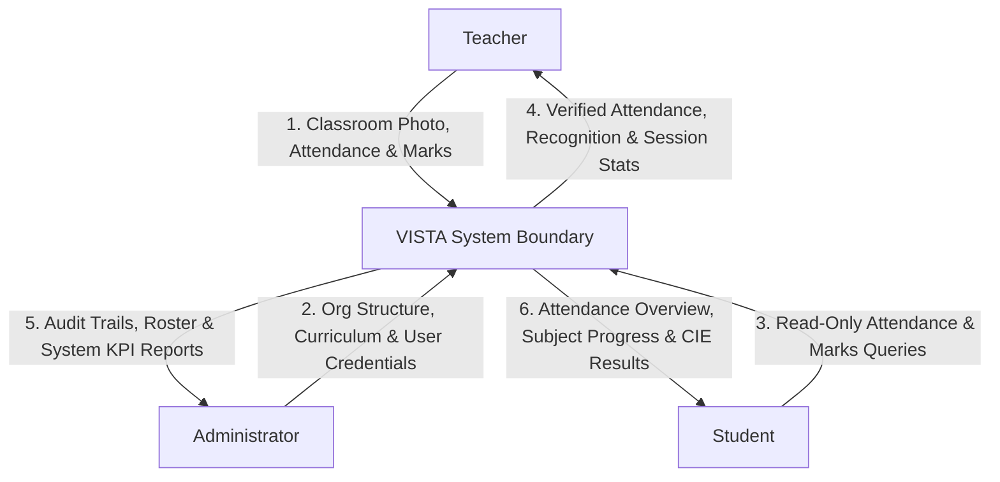
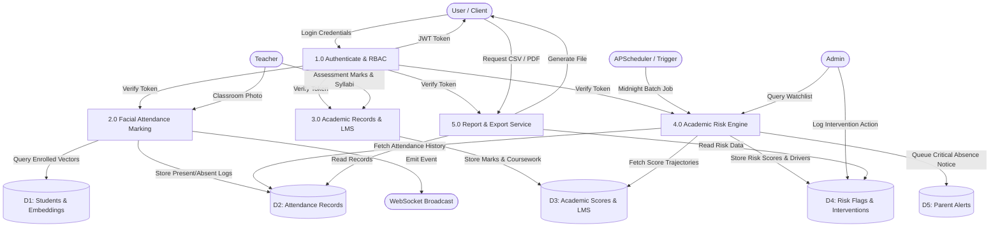
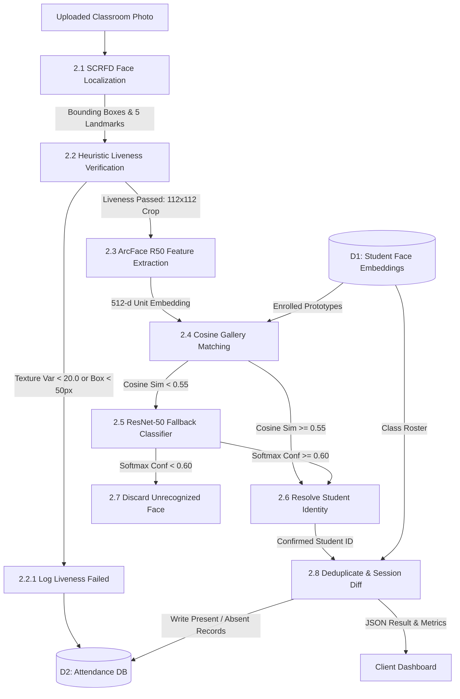

# CHAPTER 4: SYSTEM DESIGN

## 4.1 System Architecture
The VISTA system is architected as a modular, four-tier on-premise enterprise platform comprising the **Presentation Tier**, **Application Tier**, **Intelligence Tier**, and **Data Tier**. Figure 4.1 illustrates the architectural hierarchy, inter-module communication protocols, and boundary isolation.

**Fig 4.1: High-Level Four-Tier System Architecture of VISTA**

### Architectural Tier Descriptions:
1. **Presentation Layer (Tier 1):** Built using React 18, Vite, and Tailwind CSS v4, this tier provides dedicated, role-scoped user workspaces for the three active institutional roles (Admin, Teacher, Student). Components connect to the backend exclusively via an Axios REST client (`src/api/client.js`) and persistent WebSocket streams for live dashboard KPI telemetry.
2. **Application Layer (Tier 2):** Implemented in FastAPI, this tier serves 122 registered routes (114 API endpoints across 14 modules). It enforces JSON Web Token (JWT) cryptographic authentication with role-based access decorators (`permissions.py`), supervises audit logging, exposes Prometheus telemetry, and executes automated midnight batch risk assessments via APScheduler.
3. **Intelligence Layer (Tier 3):** Encapsulates the computer vision and machine learning engines. The vision pipeline coordinates SCRFD detection, heuristic liveness, ArcFace feature extraction, and ResNet-50 classifier fallback. The risk prediction pipeline computes 8 engineered behavioral features and feeds XGBoost decision trees paired with SHAP explainability.
4. **Data Layer (Tier 4):** Anchored by a 27-table relational database schema managed via SQLAlchemy 2.0 ORM (PostgreSQL in production, SQLite in development) alongside an in-memory Redis instance for token blocklisting and session caching.

---

## 4.2 Use Cases and Actor Interactions

### 4.2.1 Actor Roles and Operational Scopes
The platform partitions operations across three primary human actors as defined in Table 4.1.

**Table 4.1: Actor Roles and Scope of Operations**

| Actor | Institutional Scope | Core Responsibilities |
|---|---|---|
| **Admin** | Institution & Department Wide | System-wide control centre; provisions teacher and student accounts; manages class sections and 4th Year AIML curriculum; registers student face prototypes; executes manual attendance and CIE marks entry with audit logging; inspects full cohort risk analytics. |
| **Teacher** | Assigned Classes & Subjects | Captures lecture images via live web camera or image upload; automated SCRFD + ArcFace attendance marking; inspects confidence rates; toggles roster attendance corrections; enters CIE 1 & 2 marks; executes manual entries with mandatory audit reasons. |
| **Student** | Self-Service (Own Record Only) | Strictly read-only portal; views bounded attendance percentage (0–100%); tracks subject-wise attendance across all 5 active courses; inspects CIE 1 and CIE 2 results; drills down into date-wise attendance history with source badges (`Face`, `Manual`, `Seed`). |

### 4.2.2 System Use Case Specifications
Table 4.2 details the primary functional use cases supported by the platform.

**Table 4.2: Use Case Specifications for Primary Operational Workflows**

| Use Case ID | Use Case Name | Primary Actor | Preconditions | Postconditions |
|---|---|---|---|---|
| **UC-01** | User Authentication | Any Registered Actor | Valid institutional email and bcrypt-hashed password exist. | JWT token issued; user redirected to role-scoped dashboard. |
| **UC-02** | Mark Attendance via Photo | Teacher | Teacher assigned to class session; classroom photo captured. | Present records written to DB; attendance summary broadcasted. |
| **UC-03** | Manual Attendance Override | Teacher / Admin | Attendance session exists for specified date and classroom. | Attendance status updated; audit record logged with reason. |
| **UC-04** | Enroll Student Face | Teacher / Admin | Minimum 3 unoccluded facial photographs uploaded. | Normalized 512-dim ArcFace prototype embedding persisted in DB. |
| **UC-05** | View Academic Risk Watchlist| Admin| Daily risk recalculation executed or triggered on-demand. | At-risk student list displayed with severity levels and SHAP drivers. |
| **UC-06** | Log Teacher / Adminship Intervention | Teacher / Admin | Student flagged in risk watchlist; counseling session conducted.| Intervention note, action item, and review date stored in DB. |
| **UC-07** | Export Attendance Report | Teacher / Admin | Attendance session records exist for specified date range. | Formatted CSV or ReportLab PDF report downloaded. |
| **UC-08** | Access Student Self-Portal | Student | Student authenticated with active enrollment status. | Personal attendance stats, timetable, and study materials displayed. |

### 4.2.3 Use Case Diagram
Figure 4.2 models the interactions between the institutional actors and core functional use cases.

**Fig 4.2: Use Case Diagram for Multi-Role Operations**

### 4.2.4 Detailed Operational Flow for Primary Use Case: UC-02 (Mark Photo Attendance)
1. **Trigger:** Teacher logs into the Teacher Portal and navigates to the "Mark Attendance" console during an active lecture session.
2. **Input:** Teacher selects the class section (e.g., `AIML-4A`), specifies the subject, and captures or uploads an in-class photograph.
3. **Execution Steps:**
   - The React client packages the image file as a `multipart/form-data` payload and transmits a `POST` request to `/api/v1/attendance/mark`.
   - The FastAPI route handler verifies the teacher's JWT bearer token and invokes `vista.vision.recognize.recognize(image_path)`.
   - The SCRFD ONNX model detects all human faces in the image, outputting bounding box coordinates and 5-point facial landmarks.
   - For each detected face, `vista.vision.liveness.check_liveness()` evaluates detection confidence, bounding box width ($\ge 50$ px), and Laplacian texture variance ($\ge 20.0$). Faces failing heuristic liveness are logged with status `liveness_failed`.
   - Faces passing liveness are normalized and passed to ArcFace R50, yielding a 512-dimensional unit vector.
   - The vector is compared against all enrolled class embeddings in memory using cosine similarity. If $\text{sim} \ge 0.55$, the student identity is confirmed.
   - If cosine similarity $< 0.55$, the face crop is passed to the localized PyTorch ResNet-50 classifier (`personal_classifier.py`). If the classifier confidence $\ge 0.60$, the identity is confirmed via the fallback path.
   - If both matching paths fail, the face is logged as unrecognized and discarded without inserting a database record.
   - For all confirmed student identities, the attendance service creates new records in the `attendance` table with status `present`, session date, and timestamp.
   - The endpoint queries the class roster, derives absent students by diffing roster entries against present records, and computes real-time session percentages.
4. **Output:** The API returns a JSON response containing marked count, present student list, and unrecognized face count. The teacher interface updates immediately, and live attendance metrics are broadcasted to connected dashboards via WebSocket (`/ws/dashboard`).

---

## 4.3 Data Flow Diagrams (DFD)

### 4.3.1 DFD Level 0 — Context Diagram
Figure 4.3 depicts the top-level context diagram representing external entity interactions with the unified VISTA boundary.

**Fig 4.3: Data Flow Diagram (Level 0 — Context Diagram)**

### 4.3.2 DFD Level 1 — Functional Decomposition
Figure 4.4 illustrates the Level 1 functional decomposition, detailing the data flow across the primary subsystems: Authentication, Vision Attendance, Academics/LMS, Risk Engine, and Reporting.

**Fig 4.4: Data Flow Diagram (Level 1 — Functional Decomposition)**

### 4.3.3 DFD Level 2 — Facial Recognition & Attendance Processing
Figure 4.5 details the inner data transformations of Process 2.0 (Facial Attendance Marking Subsystem).

**Fig 4.5: Data Flow Diagram (Level 2 — Facial Recognition & Attendance Process)**
