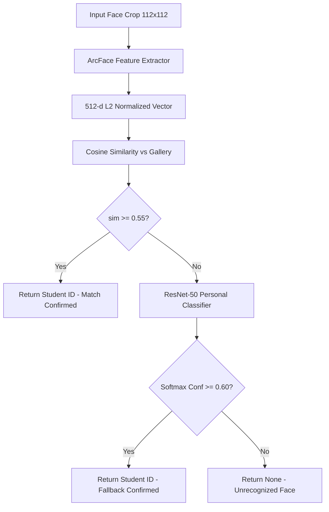
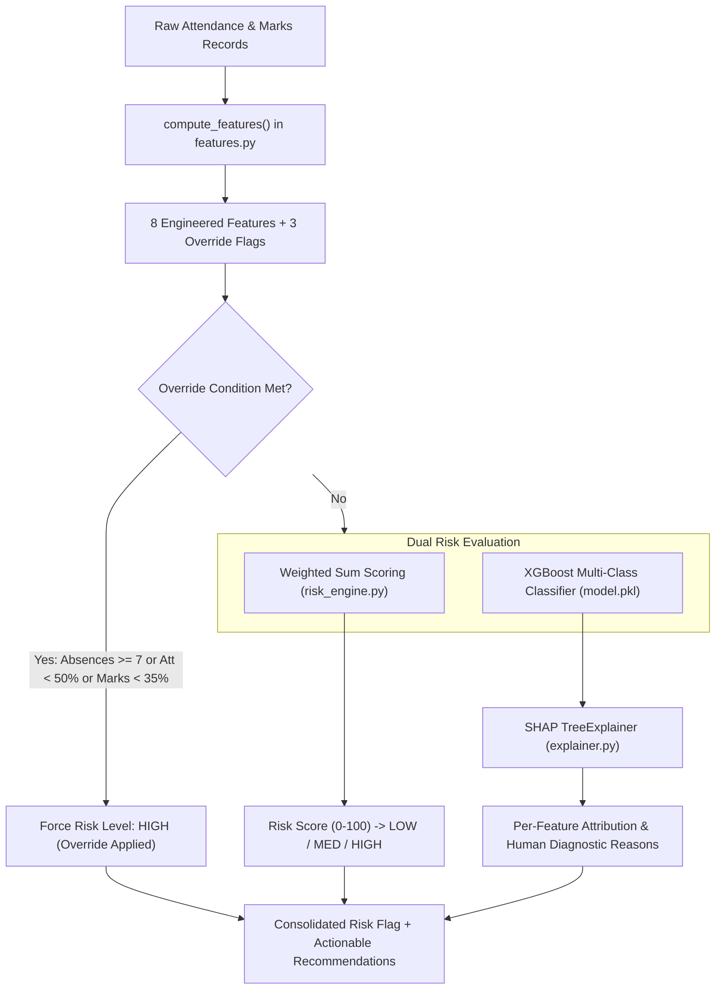

# CHAPTER 5: IMPLEMENTATION

## 5.1 Introduction
The implementation phase translates the architectural models, mathematical formulations, and relational schemas into functional software components. VISTA is organized into four decoupled sub-projects: `vista/vision/`, `vista/backend/`, `vista/ml/`, and `vista/frontend/`. This chapter details the technical implementation of each module, highlighting algorithm workflows, dual-inference fallback logic, database mappings, and deployment containerization.

---

## 5.2 Module Implementation

### 5.2.1 Computer Vision Module (`vista/vision/`)
The computer vision subsystem operates as an autonomous, self-contained Python package responsible for image decoding, face detection, liveness screening, feature embedding, and identity matching:
- **`detect.py`:** Wraps InsightFace's `FaceAnalysis` model pack (`buffalo_l`). The `FaceDetector` class initializes the `det_10g.onnx` SCRFD engine, binding it to ONNX Runtime's CPU execution provider with an input resolution of $640 \times 640$. It extracts face bounding boxes, confidence scores, and 5 facial keypoints.
- **`embed.py`:** Encapsulates the ArcFace ResNet-50 backbone (`w600k_r50.onnx`). It provides `normalize_embedding(vector)` to enforce unit L2 length, `average_embeddings(list)` to aggregate multi-angle student enrollment vectors into a stable master prototype, and JSON serialization utilities.
- **`liveness.py`:** Executes heuristic anti-spoofing via `check_liveness()`. It enforces three constraints: detection confidence $\ge 0.5$, bounding box minimum dimension $\ge 50$ px, and Laplacian texture variance $\ge 20.0$. The Laplacian variance is computed on grayscale face crops as $\sigma^2 = \text{Var}(\nabla^2 I)$, effectively flagging smooth 2D paper printouts and low-frequency presentation attacks.
- **`match.py`:** The `FaceMatcher` class performs cosine distance matrix multiplications between query embeddings and the in-memory enrollment gallery, applying the default threshold of $0.55$.
- **`personal_classifier.py`:** Implements a secondary PyTorch classification fallback using an ImageNet-pretrained ResNet-50 backbone (`best_model_npz_splitB.pth`) fine-tuned on the 20-student cohort. Face crops are resized to $112 \times 112$ and normalized with mean $0.5$ and standard deviation $0.5$.
- **`tracker.py`:** Implements `FaceTracker` for multi-frame identity persistence using greedy Intersection-over-Union (IoU) spatial matching across consecutive frames, assigning consistent track IDs without Kalman matrix computational overhead.
- **`recognize.py`:** Coordinates the dual-inference pipeline. For each detected face, it first attempts ArcFace cosine matching against the student gallery. If cosine similarity $< 0.55$, it invokes the ResNet-50 classifier; if classifier softmax confidence $\ge 0.60$, the student identity is accepted via the secondary path.

**Fig 5.1: Multi-Stage Facial Recognition and Dual-Inference Pipeline Flow**

### 5.2.2 Backend Application and API Layer (`vista/backend/`)
The backend is built with FastAPI and Uvicorn, listening on port **8002** under the `/api/v1/` prefix. The service architecture separates routing, business logic, ORM models, and background tasks:
- **`app/main.py`:** Creates the FastAPI application factory, configures CORS middleware for frontend origins, instruments Prometheus metrics handlers (`/metrics`), mounts all 14 modular routers, and initializes database tables.
- **`app/db.py`:** Initializes the SQLAlchemy 2.0 engine, manages scoped session generators (`get_db`), and executes an idempotent startup database seeder that populates multi-tier institution trees, course subjects, sample students, and timetable slots.
- **`app/permissions.py`:** Implements role-based access control (RBAC). Defines `get_current_user` to decode and validate JWT bearer tokens, and provides parameterized dependencies `require_role([...])` scoping endpoints to permitted roles (`admin`, `teacher`, `student`).
- **`app/scheduler.py`:** Uses APScheduler's `BackgroundScheduler` to register an automated cron job executing daily at midnight (`00:00:00`). The job iterates through all active students, computes longitudinal risk indicators, updates `risk_flags`, and queues parent absence notices in `parent_alerts`.
- **`app/websocket.py`:** Implements `ConnectionManager` to maintain active client WebSocket connections at `/ws/dashboard`. It broadcasts JSON event payloads whenever attendance is marked or risk scores change.
- **`app/routes/`:** Encompasses 14 distinct route modules exposing 110 endpoints, detailed in Table 5.1.

**Table 5.1: Implemented Backend API Route Modules and Endpoint Breakdown**

| Module File | Route Prefix | Endpoint Count | Key Responsibilities |
|---|---|---|---|
| `auth.py` | `/api/v1/auth` | 7 | User authentication, token issuance, logout blocklisting, password resets |
| `academics.py` | `/api/v1/academics` | 23 | Classrooms, departments, sections, subjects, timetables, and teacher allocations |
| `admin.py` | `/api/v1/admin` | 29 | Enterprise user provisioning, organization hierarchy tree, audit trail inspection |
| `attendance.py` | `/api/v1/attendance` | 8 | Image-based attendance marking, manual roll calls, session logs, teacher overrides |
| `dashboards.py` | `/api/v1/dashboards` | 7 | Scoped KPI analytics aggregated for Admin, Teacher, and Student |
| `enroll.py` | `/api/v1/enroll` | 2 | Single and batch facial image feature extraction and database enrollment |
| `export.py` | `/api/v1/export` | 1 | Streaming CSV export of attendance and academic performance records |
| `lms.py` | `/api/v1/lms` | 4 | Course assignments, student file submissions, syllabus progress tracking |
| ~~`mentor.py`~~ | ~~`/api/v1/mentor`~~ | *Deprecated* | Assigned student directories, high-risk watchlists, remedial intervention logs |
| `notifications.py`| `/api/v1/notifications`| 4 | In-app alerts, campus-wide announcements, unread status tracking |
| `reports.py` | `/api/v1/reports` | 1 | Programmatic PDF generation of student academic transcripts via ReportLab |
| `risk.py` | `/api/v1/risk` | 5 | Roster risk flags, on-demand student recalculation, SHAP factor breakdown queries |
| `student_portal.py`| `/api/v1/student` | 10 | Student personal attendance percentage, timetable, marks, and study materials |
| `students.py` | `/api/v1/students` | 3 | Student directory, individual profile lookup, biographic CRUD |
| `main.py` (System) | `/`, `/health`, `/ws` | 4 | System health checks, Prometheus metrics, WebSocket dashboard broadcast |
| **Total** | | **120** | Complete production enterprise REST & WebSocket API |

### 5.2.3 Relational Database Schema (`vista/backend/app/models/`)
The database architecture comprises 27 tables declared across 8 model modules in `vista/backend/app/models/`. Table 5.2 lists all tables, foreign key constraints, and operational purposes.

**Table 5.2: Database Relational Schema Specification (27 Tables)**

| Module | Table Name | Primary Key | Foreign Keys & Relationships | Operational Purpose |
|---|---|---|---|---|
| `organization.py` | `schools` | `id` (UUID) | None | Top-level academic divisions / faculties |
| `organization.py` | `departments` | `id` (UUID) | `school_id` $\to$ `schools.id` | Academic departments within schools |
| `organization.py` | `classrooms` | `classroom_id` (TEXT) | None | Physical lecture halls and lab rooms |
| `organization.py` | `class_sections` | `id` (UUID) | `department_id` $\to$ `departments.id` | Student semester sections (e.g., AIML-4A) |
| `organization.py` | `subjects` | `id` (UUID) | `department_id` $\to$ `departments.id` | Academic course units and credit values |
| `organization.py` | `teacher_subjects` | `id` (UUID) | `teacher_id` $\to$ `users.id`, `subject_id` $\to$ `subjects.id` | Teacher allocation to courses and sections |
| `organization.py` | `access_requests` | `id` (UUID) | `requester_id` $\to$ `users.id` | Permission escalation and access approvals |
| `user.py` | `users` | `id` (UUID) | None (Stores hashed credentials & role) | System user accounts across all 3 roles (Admin, Teacher, Student) |
| `student.py` | `students` | `student_id` (TEXT) | `class_section_id` $\to$ `class_sections.id` | Student roster, roll number, and 512-d embedding |
| `student.py` | `semester_results` | `id` (UUID) | `student_id` $\to$ `students.student_id` | Historical semester SGPA, CGPA, backlogs |
| `student.py` | `study_materials` | `id` (UUID) | `subject_id` $\to$ `subjects.id` | Uploaded lecture notes and syllabi |
| `attendance.py` | `attendance` | `id` (UUID) | `student_id` $\to$ `students.student_id` | Timestamped presence/absence/liveness records |
| `attendance.py` | `scores` | `id` (UUID) | `student_id` $\to$ `students.student_id` | Continuous internal evaluation assessment marks |
| `attendance.py` | `risk_flags` | `id` (UUID) | `student_id` $\to$ `students.student_id` | Computed risk score, risk level, and driver JSON |
| `attendance.py` | `parent_alerts` | `id` (UUID) | `student_id` $\to$ `students.student_id` | Queued parent notifications for attendance drops |
| `timetable.py` | `timetable_slots` | `id` (UUID) | `subject_id` $\to$ `subjects.id`, `class_section_id` $\to$ `class_sections.id` | Weekly scheduled periods by day and time |
| `notification.py` | `notifications` | `id` (UUID) | `user_id` $\to$ `users.id` | Role-targeted system notifications |
| `notification.py` | `announcements` | `id` (UUID) | None | Department-wide broadcast bulletins |
| `intervention.py` | `interventions` | `id` (UUID) | `student_id` $\to$ `students.student_id`, `mentor_id` $\to$ `users.id` | Remedial counseling logs and recorded outcomes |
| `intervention.py` | `mentor_assignments` | `id` (UUID) | `student_id` $\to$ `students.student_id`, `mentor_id` $\to$ `users.id` | Faculty mentor-to-mentee mappings |
| `intervention.py` | `parent_contacts` | `id` (UUID) | `student_id` $\to$ `students.student_id` | Verified parent phone numbers and emails |
| `audit.py` | `audit_logs` | `id` (UUID) | `user_id` $\to$ `users.id` | Security audit trail with IP address and timestamp |
| LMS | `assignments` | `id` (UUID) | `subject_id` $\to$ `subjects.id` | Coursework homework and lab assignments |
| LMS | `assignment_submissions`| `id` (UUID) | `assignment_id` $\to$ `assignments.id`, `student_id` $\to$ `students.student_id` | Student file uploads and assigned grades |

---

## 5.3 Model Development

### 5.3.1 Longitudinal Academic Feature Engineering (`vista/ml/features.py`)
The risk engine converts raw attendance timestamps and examination marks into an 8-dimensional normalized feature vector:
1. **`attendance_percentage` ($f_1$):** Ratio of attended sessions to total conducted sessions:
   $$f_1 = \frac{N_{\text{attended}}}{N_{\text{total}}} \times 100$$
2. **`attendance_drop_percentage` ($f_2$):** Rate of attendance change between the first half and second half of the semester window:
   $$f_2 = \text{AttendanceRate}_{\text{first\_half}} - \text{AttendanceRate}_{\text{second\_half}}$$
3. **`internal_marks_average` ($f_3$):** Mean percentage obtained across all internal continuous assessments:
   $$f_3 = \frac{1}{M} \sum_{i=1}^M \left( \frac{\text{score}_i}{\text{max\_score}_i} \times 100 \right)$$
4. **`marks_decline_percentage` ($f_4$):** Percentage drop from the student's peak assessment score to their latest score:
   $$f_4 = \max\left(0, \frac{\text{score}_{\text{peak}} - \text{score}_{\text{latest}}}{\text{score}_{\text{peak}}} \times 100\right)$$
5. **`assignment_completion_rate` ($f_5$):** Proportion of issued LMS assignments submitted on time. Set to `None` if no assignments have been issued.
6. **`consecutive_absence_count` ($f_6$):** Current unbroken run of missed lecture sessions.
7. **`performance_trend` ($f_7$):** Directional slope of the last 3 assessment scores categorized as `IMPROVING`, `STABLE`, or `DECLINING` using a $\pm 5.0\%$ noise margin.
8. **`engagement_score` ($f_8$):** Composite behavioral metric:
   $$f_8 = \begin{cases} 0.6 f_1 + 0.4 f_5, & \text{if } f_5 \neq \text{None} \\ f_1, & \text{if } f_5 = \text{None} \end{cases}$$

### 5.3.2 Critical Override Engine & Rule Scoring (`vista/ml/risk_engine.py`)
Before statistical modeling, the system checks three deterministic safety override conditions:
- **Rule 1 (Chronic Absence Streak):** If $f_6 \ge 7$ consecutive absences $\implies$ force risk level to `HIGH`.
- **Rule 2 (Critical Attendance Deficit):** If $f_1 < 50.0\%$ overall attendance $\implies$ force risk level to `HIGH`.
- **Rule 3 (Academic Collapse):** If $f_3 < 35.0\%$ average internal marks $\implies$ force risk level to `HIGH`.

If no critical override fires, the system computes a weighted composite risk score ($S \in [0, 100]$):
$$S = 0.30(100 - f_1) + 0.25(100 - f_3) + 0.15\min(100, 3 f_2) + 0.15\min(100, 2.5 f_4) + 0.10\min(100, 12 f_6) + 0.05(100 - f_8)$$
Score boundaries: $S < 40 \implies \text{LOW}$, $40 \le S < 70 \implies \text{MEDIUM}$, $S \ge 70 \implies \text{HIGH}$.

### 5.3.3 Machine Learning Classification & SHAP XAI (`vista/ml/explainer.py`)
In parallel with rule-based scoring, an XGBoost classifier (`model.pkl`) predicts multi-class risk probabilities from 5 normalized signals: `overall_attendance`, `recent_attendance`, `avg_score`, `recent_score`, and `failed_subjects`.

To provide causal transparency, `vista/ml/explainer.py` initializes SHAP's `TreeExplainer(model)` to decompose the prediction into additive feature contributions. The raw Shapley values $\phi_j$ are sorted by magnitude and converted into natural-language diagnostic driver statements (e.g., *"Overall attendance at 52% — below recommended level"*, *"Recent marks dropped by 18 points"*), enabling mentors to understand the exact root cause of student distress.

**Fig 5.2: Academic Risk Feature Vector Extraction and Classification Workflow**

---

## 5.4 Deployment Details
The platform is containerized using Docker Compose and configured for on-premise institutional server deployment as specified in Table 5.3.

**Table 5.3: Deployment and Infrastructure Specifications**

| Component | Technology | Port | Configuration Parameters |
|---|---|---|---|
| **Backend API** | FastAPI / Uvicorn | `8002` | `PORT=8002`, `VISTA_JWT_SECRET`, `VISTA_FACE_MATCH_THRESHOLD=0.55` |
| **Frontend UI** | Vite / React SPA | `5173` | Proxies `/api` and `/ws` to `http://localhost:8002` via `vite.config.js` |
| **Relational DB** | PostgreSQL 16 Alpine | `5432` | `POSTGRES_DB=vista`, `POSTGRES_USER=postgres`, `POSTGRES_PASSWORD` |
| **In-Memory Cache** | Redis 7 Alpine | `6379` | `REDIS_URL=redis://localhost:6379/0` (In-memory fallback if absent) |
| **Metrics Exporter**| Prometheus Client | `8002` | Endpoint: `http://localhost:8002/metrics` |
| **WebSocket Stream**| FastAPI WebSockets | `8002` | Endpoint: `ws://localhost:8002/ws/dashboard` |

---

## 5.5 Summary
The implementation successfully establishes a robust, decoupled, and highly performant architecture. By uniting InsightFace SCRFD and ArcFace with a secondary PyTorch ResNet-50 classifier, the vision subsystem achieves resilient face localization and identification. The backend implements 120 endpoints and 27 relational tables, enforcing 3-role RBAC security (Admin, Teacher, Student) and scheduled midnight risk computations. Finally, the longitudinal risk engine couples XGBoost classification with SHAP XAI attributions, delivering full operational transparency to academic stakeholders.
