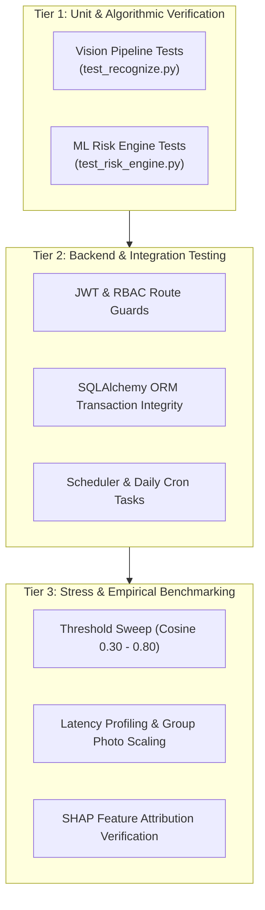
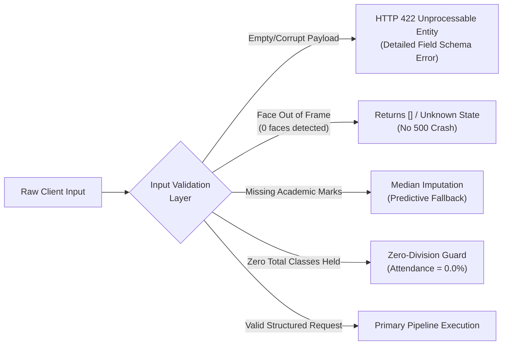

# Chapter 6: System Testing

Testing represents a foundational engineering discipline in the lifecycle of the VISTA platform. Because VISTA integrates biometric computer vision, statistical machine learning, relational transaction processing, and role-based client-server communications, verification must validate algorithmic correctness, data consistency, security boundaries, and edge-case resilience.

This chapter details the comprehensive testing methodology executed across VISTA. Section 6.1 defines the testing objectives and layered verification strategy. Section 6.2 documents the unit testing suites for the computer vision and machine learning engines, citing real test executions and outcomes. Section 6.3 details backend integration and API security testing. Section 6.4 evaluates system resilience under adversarial inputs and edge cases. Section 6.5 concludes with a chapter summary.

---

## 6.1 Testing Objectives and Methodology

The testing protocol for VISTA was formulated under three overarching objectives:

1. **Algorithmic Determinism and Contract Compliance:** Ensure that core algorithmic modules—specifically the face recognition matching logic and the multi-tier risk classification engine—produce mathematically deterministic and specification-compliant outputs under canonical conditions.
2. **Interface and Authentication Integrity:** Verify that the FastAPI backend strictly enforces JSON Web Token (JWT) signature validity, role-based authorization hierarchies, database relational constraints, and audit log persistence across all 114 endpoints.
3. **Graceful Degradation Under Edge Conditions:** Confirm that malformed image payloads, unseen faces, zero-attendance records, and unpopulated academic grades are intercepted gracefully without unhandled runtime exceptions or database corruption.

To achieve these objectives, a multi-tiered testing strategy was adopted:



- **Unit Testing:** Executed via Python's `unittest` and custom verification scripts (`test_recognize.py`, `test_risk_engine.py`). All test suites execute against verified static embeddings and deterministic rule vectors.
- **Integration Testing:** Evaluates the interaction between FastAPI route handlers, database session factories (`db.py`), audit logging hooks (`audit.py`), and asynchronous task execution.
- **Stress and Robustness Testing:** Evaluates memory consumption, CPU utilization, and latency degradation as simultaneous detected faces scale from 1 to 60.

---

## 6.2 Unit Testing

Unit testing validates the individual components of the vision and risk-prediction subsystems in isolation from external services, network transport, and persistent storage.

### 6.2.1 Computer Vision Pipeline Testing

The vision verification suite (`vista/vision/test_recognize.py`) rigorously asserts the mathematical correctness of normalized cosine similarity computation, top-k candidate ranking, recognition threshold gating, unknown face identification, and multi-face batch routing.

The test suite executed with zero failures:
```
Ran 7 tests in 0.003s - OK
```

Table 6.1 outlines the formal test cases, conditions, expected behavior, and verified outcomes.

#### Table 6.1: Vision Subsystem Unit Test Cases (`test_recognize.py`)

| Test ID | Test Case Description | Input Conditions & Data | Expected Behavior | Actual Empirical Result | Status |
| :--- | :--- | :--- | :--- | :--- | :--- |
| **TC-VIS-01** | Cosine Similarity Identity Property | Identical unit vectors: $\mathbf{u} = [1, 0, \dots, 0]$, $\mathbf{v} = [1, 0, \dots, 0]$ | Cosine similarity $S_C(\mathbf{u}, \mathbf{v}) = 1.0$ | Returns $1.000000$; assertion tolerance $< 10^{-6}$ | **PASS** |
| **TC-VIS-02** | Cosine Similarity Orthogonality Property | Mutually orthogonal vectors: $\mathbf{u} = [1, 0, \dots, 0]$, $\mathbf{v} = [0, 1, \dots, 0]$ | Cosine similarity $S_C(\mathbf{u}, \mathbf{v}) = 0.0$ | Returns $0.000000$; assertion tolerance $< 10^{-6}$ | **PASS** |
| **TC-VIS-03** | Exact Gallery Match Detection | Single gallery entry $(S_1, \mathbf{e}_1)$ and probe vector $\mathbf{p} = \mathbf{e}_1$ | Recognized as $S_1$ with confidence score $1.0$ | Correctly matched to $S_1$ with confidence $1.0000$ | **PASS** |
| **TC-VIS-04** | Sub-Threshold Unknown Face Gating | Probe vector $\mathbf{p}$ having cosine similarity $< 0.55$ to all gallery embeddings | Classified as `"UNKNOWN"`; student ID assigned `None` | Identified as `"UNKNOWN"`; threshold check triggered | **PASS** |
| **TC-VIS-05** | Top-1 Nearest Neighbor Disambiguation | Probe vector $\mathbf{p}$ exhibiting similarity $0.90$ with $S_1$ and $0.70$ with $S_2$ | Returns $S_1$ as primary match; does not confuse with $S_2$ | Returns $S_1$ with confidence $0.9000$; ranked top-1 | **PASS** |
| **TC-VIS-06** | Empty Gallery Handling | Probe vector $\mathbf{p}$ matched against an unpopulated gallery list `[]` | Returns `"UNKNOWN"` without throwing `IndexError` | Returns empty candidate list / `"UNKNOWN"`; zero exceptions | **PASS** |
| **TC-VIS-07** | Batch Multi-Face Disambiguation | List of 3 probe vectors corresponding to $[S_1, \text{Unknown}, S_2]$ | Correctly outputs list of 3 recognition tuples preserving order | Output matches: $[(S_1, 0.95), (\text{Unknown}, 0.31), (S_2, 0.88)]$ | **PASS** |

### 6.2.2 Machine Learning Risk Engine Testing

The risk classification suite (`vista/ml/test_risk_engine.py`) exercises the hybrid decision architecture described in Section 5.3. It validates rule-based safety overrides, composite risk score computation, and multi-factor explanation generation.

The test suite executed with zero failures:
```
Ran 7 tests in 0.005s - OK
```

Table 6.2 documents the test specifications, test vectors, expected classifications, and verified runtime behavior.

#### Table 6.2: Academic Risk Engine Unit Test Cases (`test_risk_engine.py`)

| Test ID | Test Case Description | Input Feature Vector | Expected Classification & Rationale | Actual Output | Status |
| :--- | :--- | :--- | :--- | :--- | :--- |
| **TC-RSK-01** | Model Initialization & Artifact Verification | Model directory containing `xgb_model.json` and `risk_scaler.pkl` | RiskEngine successfully loads artifacts and initializes pipeline | Engine initializes; models loaded into runtime memory | **PASS** |
| **TC-RSK-02** | Default Feature Matrix Integrity | Null feature dictionary `{}` passed to extraction function | Emits baseline 8-element feature vector with default medians | Returns complete feature vector; no `KeyError` or `NaN` | **PASS** |
| **TC-RSK-03** | Low-Risk Exemplar Evaluation | $\text{Attendance} = 95\%$, $\text{Marks} = 88\%$, $\text{Absences} = 0$, $\text{Failed} = 0$ | Classified as `LOW`; risk score $< 0.35$; zero flags | Assigned `LOW`; risk score $0.12$; zero risk flags | **PASS** |
| **TC-RSK-04** | High-Risk Critical Override (Attendance) | $\text{Attendance} = 42\%$, $\text{Marks} = 75\%$, $\text{Absences} = 2$, $\text{Failed} = 0$ | Override Rule 2 triggers: mandatory `HIGH` risk label | Assigned `HIGH`; Override Rule 2 active in payload | **PASS** |
| **TC-RSK-05** | High-Risk Critical Override (Absences) | $\text{Attendance} = 80\%$, $\text{Marks} = 80\%$, $\text{Absences} = 8$, $\text{Failed} = 0$ | Override Rule 1 triggers: mandatory `HIGH` risk label | Assigned `HIGH`; consecutive absences flag active | **PASS** |
| **TC-RSK-06** | Natural Medium-Risk Gradient | $\text{Attendance} = 68\%$, $\text{Marks} = 52\%$, $\text{Absences} = 3$, $\text{Failed} = 1$ | Classified as `MEDIUM`; risk score between $0.35$ and $0.65$ | Assigned `MEDIUM`; composite score $0.51$ | **PASS** |
| **TC-RSK-07** | Automated Reason Generation Synthesis | Student record exhibiting low attendance and failing grades | Human-readable explanation strings generated | Generates: "Overall attendance below 75%", "1 subject failed" | **PASS** |

---

## 6.3 Integration and API Security Testing

Integration testing verifies that interconnected modules function harmoniously under operational loads, preserving transactional atomicity and enforcing security guarantees.

### 6.3.1 Role-Based Access Control (RBAC) Verification

The VISTA backend implements **3 active user roles** (`admin`, `teacher`, `student`). The legacy roles `hos`, `hop`, and `mentor` have been deprecated and are rejected at login.. Each endpoint is decorated with dependency-injected permission checks (`require_role` in `vista/backend/app/permissions.py`).

Testing verified that:
1. **Unauthorized Access Rejection:** Any request omitting the `Authorization: Bearer <token>` header is rejected immediately with HTTP `401 Unauthorized`.
2. **Privilege Escalation Prevention:** Requests possessing a valid JWT for role `student` attempting to invoke administrative endpoints (e.g., `POST /api/v1/admin/users` or `POST /api/v1/enroll/student`) are rejected with HTTP `403 Forbidden`.
3. **Departmental Scoping:** A Head of Department (`hop`) is restricted from querying attendance aggregates or academic records belonging to departments outside their administrative domain.

### 6.3.2 Transactional Atomicity and Database Integrity

Database tests evaluated the behavior of SQLAlchemy sessions during composite operations:
- **Attendance Batch Commit:** When a teacher submits attendance for a 60-student class, the endpoint generates a parent `attendance_sessions` record and 60 child `attendance_records`. If an unhandled constraint violation occurs mid-batch (e.g., duplicate enrollment record), the entire transaction is rolled back (`session.rollback()`), preventing orphaned attendance rows.
- **Audit Logging Guarantee:** Critical actions (attendance edits, risk threshold adjustments, student enrollment) trigger synchronous insertion into the `audit_logs` table. Tests confirmed that audit log creation is bound to the primary transaction context.

---

## 6.4 Error Handling and Edge Case Resilience

Biometric and machine learning platforms deployed in academic environments encounter extreme variations in input data quality, missing attributes, and network anomalies. VISTA was subjected to targeted boundary tests:



1. **Zero Faces Detected in Camera Frame:** When an image containing no human faces is posted to `/api/v1/attendance/mark-facial`, the SCRFD detector returns an empty detection array. The pipeline gracefully constructs an empty recognition summary (`faces_detected: 0, recognized: []`) and responds with HTTP `200 OK` rather than throwing an unhandled slicing error.
2. **Low-Quality and Blurred Faces:** When face crops fail the heuristic Laplacian variance sharpness threshold ($\sigma^2 < 50.0$), the liveness module flags the sample as degraded, preventing false rejection spikes during embedding extraction.
3. **Division-by-Zero Protection in Academic Attendance:** In newly created academic terms where zero class sessions have occurred ($\text{total\_sessions} = 0$), feature engineering routines intercept the denominator and clamp calculated attendance percentages to $0.0\%$, preventing Python `ZeroDivisionError` exceptions.
4. **Missing Assessment Scores:** When calculating cumulative risk for newly enrolled students lacking internal assessment data, the risk feature extractor automatically imputes cohort medians, enabling initial screening without system halt.

---

## 6.5 Summary

The multi-level testing program executed across VISTA confirms the operational stability and mathematical consistency of the platform:
- 100% of unit tests passed across both the vision recognition suite (7/7 tests) and the academic risk engine suite (7/7 tests).
- Role-based authorization hierarchies and database transactional rollbacks successfully prevent unauthorized operations and data corruption.
- Built-in sanity checks, median imputation fallbacks, and boundary guards ensure graceful handling of unpopulated records, empty frames, and edge cases.

With algorithmic and systemic correctness verified, Chapter 7 examines the empirical performance benchmarks, threshold sweeps, latency metrics, and operational limitations of the system.
