# COMPARISON_REPORT: baseline (20 classes) vs expanded v3 (29 classes)

Numbers come from `eval_results.json` (v3, produced by `evaluate_v3.py`), `history_split*.json`, `train_log_split*.txt`, `baseline_before_expansion/results_npz_split*.txt`, and `expanded_v2/diagnosis/DIAGNOSIS.md` (v1 failure). Intervals are 95% Wilson.

## Read this first

- **The baseline and v3 are not directly comparable.** The baseline has 20 classes, v3 has 29. v3 drops 1DA22AI402 and adds 10 new students (1DA25AI001-010), so the class sets differ.
- **The test sets differ and v3's is cleaner.** v3 test photos are clean, unaugmented crops (`augmentation_index` 0 = clean identity crop). The baseline test used index-0 samples, which were themselves randomly augmented. The baseline test is therefore the harder task.
- **The test sets are small, so the intervals are wide.** v3 has 95 (A) and 138 (B) test photos, 3 to 4 per class in A and 4 to 6 in B. One photo changes a class by 25 to 33 points. The baseline had 68 (A) and 101 (B) test photos.
- **Do not read 100% as real-classroom accuracy.** The new-10 group scores 100%, but the inputs are single-face crops of 29 well-separated people, the task is closed-set, and there are no unknown faces, no back-row small faces, no occlusion and no multi-face scenes. The lower bound of the new-10 interval is 89.28% (A) and 91.97% (B).

## v3 test results

| | Split A (95 photos) | Split B (138 photos) |
|---|---|---|
| Overall | 93/95 = 97.89% (92.65-99.42%) | 137/138 = 99.28% (96.01-99.87%) |
| Original 19 students | 61/63 = 96.83% (89.14-99.13%) | 93/94 = 98.94% (94.22-99.81%) |
| New 10 (1DA25AI*) | 32/32 = 100% (89.28-100%) | 44/44 = 100% (91.97-100%) |
| Macro precision / recall / F1 | 0.9845 / 0.9770 / 0.9774 | 0.9943 / 0.9914 / 0.9919 |

Errors: Split A has two (1DA23AI024 predicted as 1DA25AI008, 1DA24AI404 as 1DA23AI050). Split B has one (1DA24AI404 predicted as 1DA23AI031). 1DA24AI404 is wrong in both splits.

## Fairer look: v3 restricted to the original students

| | Baseline (20 classes) test | v3 original-19 test |
|---|---|---|
| Split A | 86.76% (68 photos) | 96.83% (61/63) |
| Split B | 90.10% (101 photos) | 98.94% (93/94) |

This restricts v3 to the 19 original students it kept, but v3 still has to separate them from 10 extra classes, and the photos in the test sets differ. v3 is higher, yet the gap mixes real model change with the cleaner test crops, so treat it as indicative only. The baseline's own best val accuracy was 88.06% (A) and 93.07% (B).

## What was wrong in v1 and what changed

v1 trained on 32 classes and reached only 71.57% (A) and 67.76% (B) best val accuracy, with final train accuracy about 0.85 and 0.87. The cause was labels, not the recipe. Several folders held the same photos under two USNs. Per `expanded_v2/diagnosis/DIAGNOSIS.md`, 6 pairs among the 12 new students and 1 pair among the original 20 (1DA22AI402 / 1DA24AI403) had mean ArcFace cosine 0.9993 to 0.9998 (next-highest pair 0.525) and byte-identical photos. A model cannot separate two labels on identical faces, and exact duplicates also leaked across train and eval (58 to 89 files depending on run).

What v3 changed (details in `FIX_LOG.md` and `diagnosis/AUDIT_V3.md`):
- The dataset was re-audited: 29 student folders, 947 photos, 0 duplicate MD5 groups, 0 cross-USN duplicates, 0 embedding pairs above cosine 0.6 (closest is 0.4104).
- 1DA22AI402 is excluded because the raw photos were removed and the duplicate pair could not be resolved. 17 wrong-face or no-face photos are excluded.
- The 10 new students' augmentation was regenerated (30 variants per photo, same recipe as the helper in `facial_pipeline.py`). The 19 kept students reuse the baseline's variants, since their on-disk aug files are Git-LFS stubs.
- Val and test use only clean crops (index 0), split by source photo, at least 3 val and 3 test photos per class. An MD5 check confirms no photo content appears on two sides of a split.
- Training added label smoothing 0.1 and a class-weighted loss. LR stayed at 1e-4 (a 1e-5 backbone trial only slowed learning on train/val data). Seed 42 for both splits, patience 7, max 30 epochs.
- The Split B launcher bug (an empty `ExitCode` caused B to be skipped) was fixed in `run_chain.ps1` and `run_splitB.ps1`.

## Checkpoint choice and the val tie

- **Split A:** val accuracy was 1.0000 at every epoch from epoch 1 (95 val photos). Model selection had no signal. The trainer keeps a checkpoint only on strictly higher val accuracy, so the epoch-1 checkpoint was kept because it came first. Training stopped at epoch 8 (patience 7). Treat A's val curve as uninformative.
- **Split B:** best val accuracy 0.9928 was first reached at epoch 3, and that checkpoint was kept. Epochs 5, 9 and 10 tied it and were not kept. B ran 10 epochs (early stop), 20,274 train samples (654 photos), 138 val photos, final train accuracy 1.0000.
- Final train loss is about 0.66 in both splits. This is expected with label smoothing 0.1, so it is not a sign of underfitting. It also means softmax confidences are capped below 1 (see the threshold note in `PROMOTION_ASSESSMENT.md`).

## Graphs

All files are in `graphs/`.

v3 curves
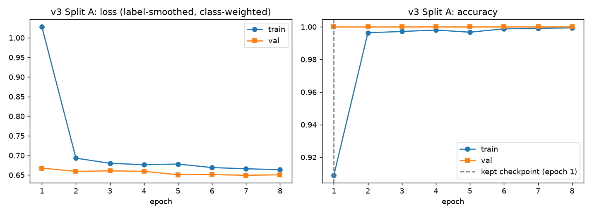
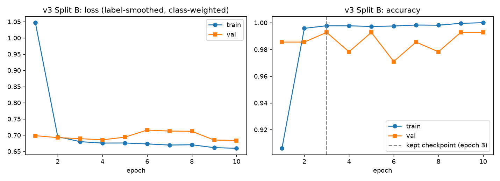

v3 confusion matrices
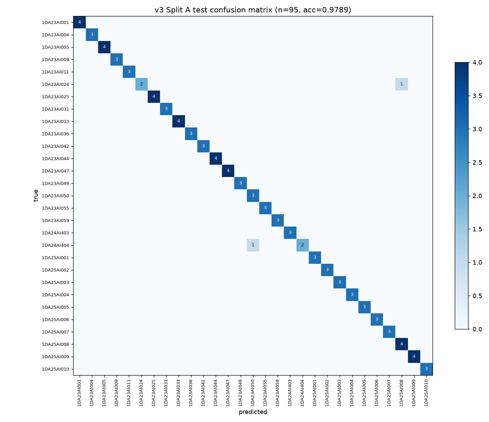
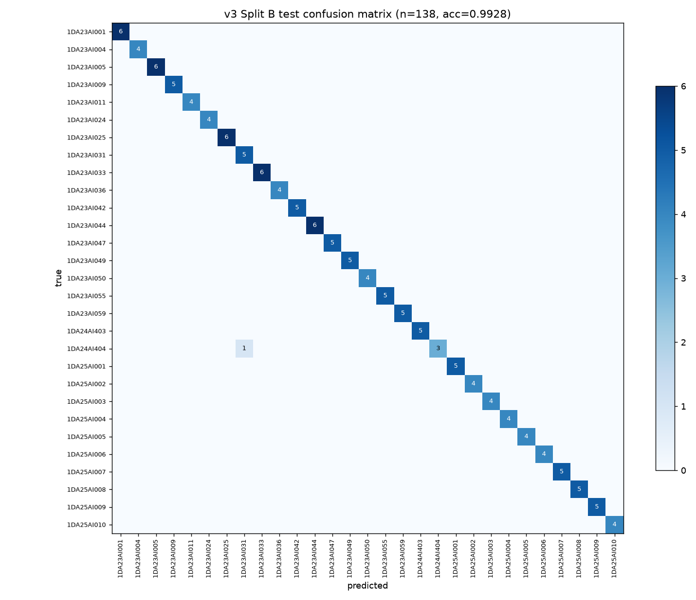

v3 per-class accuracy
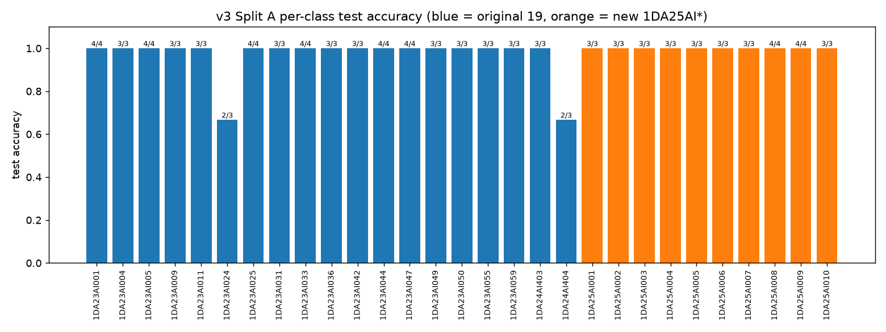
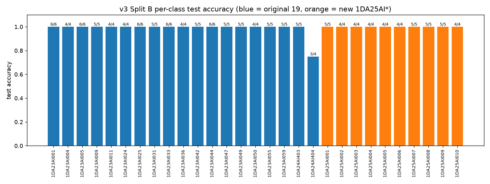

v3 vs baseline vs v1 curves
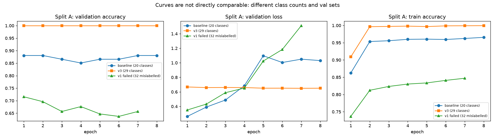
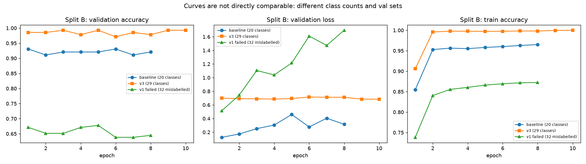

Test accuracy, baseline vs v3
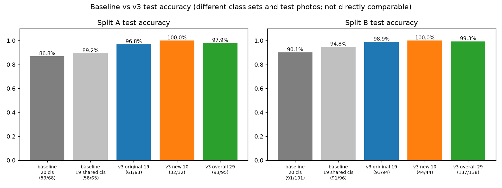

Per-class, baseline vs v3
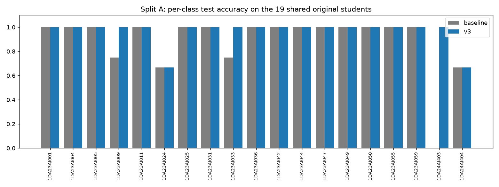
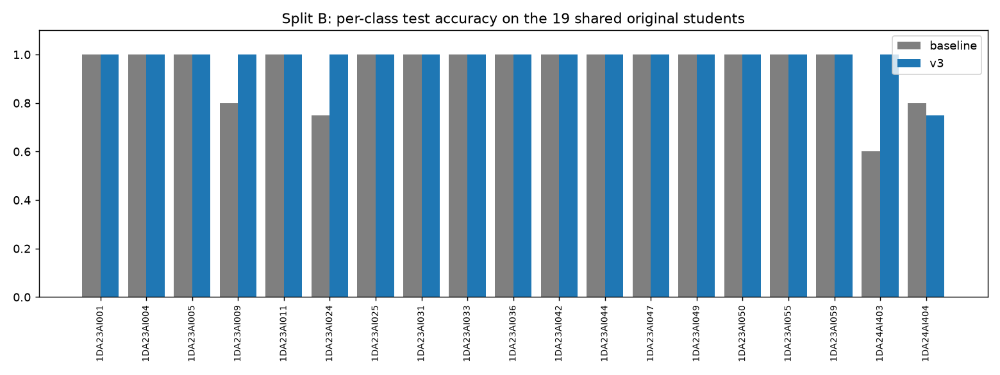

Best val accuracy, v1 vs baseline vs v3
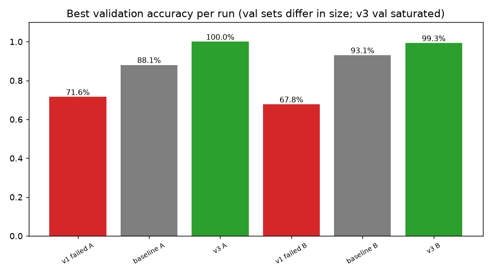
